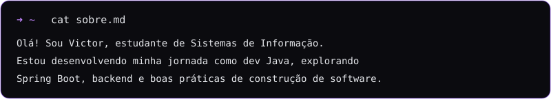
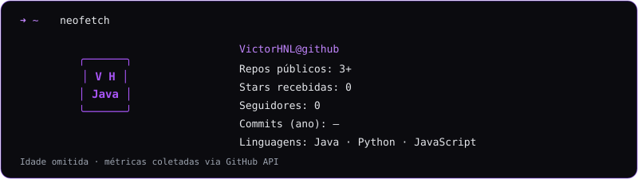
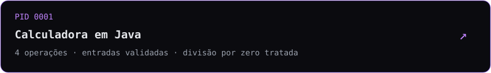
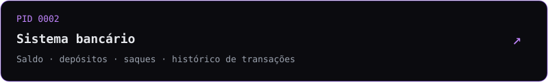
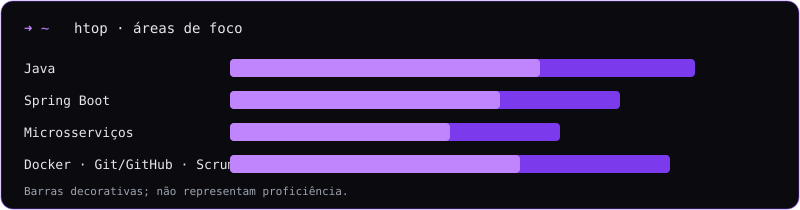
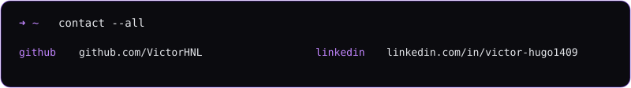

# Victor Hugo · Terminal profile

  

<a href="https://github.com/VictorHNL">GitHub</a> · <a href="https://www.linkedin.com/in/victor-hugo1409">LinkedIn</a> · Goiânia, GO

<code>cat sobre.md</code>

 

<code>neofetch</code>

 
<!-- Atualizado diariamente pela GitHub Action; números de fallback ficam embutidos no SVG. -->

<code>ls ~/projetos</code>

 

<code>htop</code>

 

<code>contact --all</code>

 

<code>➜ ~ exit</code> · Perfil atualizado em 24/10/2026

